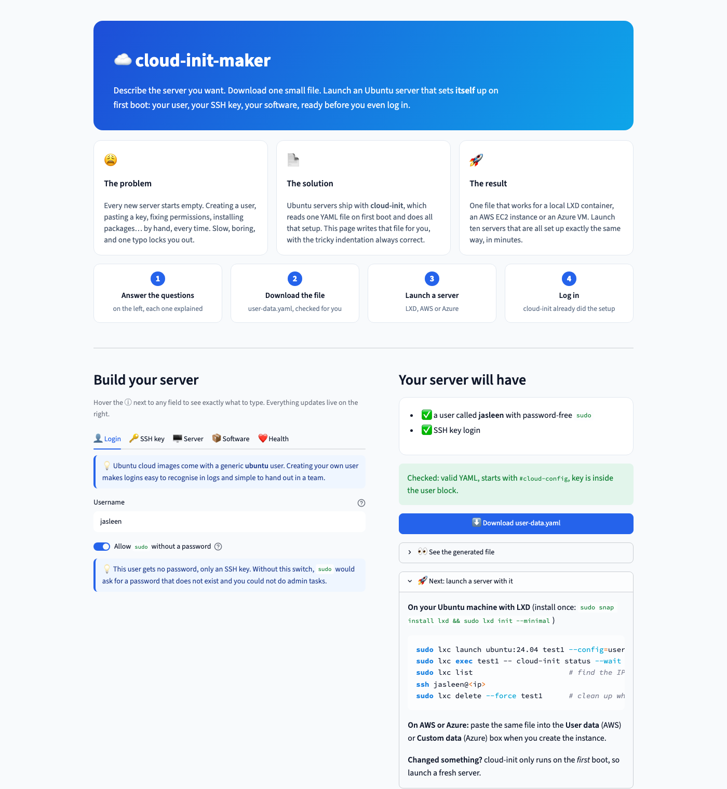

# cloud-init-maker

A small tool, as a web form or a command-line app, that asks you a few questions
and writes a valid `user-data.yaml` file for [cloud-init](https://cloud-init.io/).
Use that file to launch an Ubuntu server that comes up with your user, your SSH
key, your packages and (optionally) an hourly health checker already in place.
Works with LXD containers locally and with any cloud that supports cloud-init
(AWS, Azure, DigitalOcean, Multipass, ...).

**Try it online:** https://cloud-init-maker-jazz.streamlit.app

## Why

Setting up servers by hand is slow and error-prone: create a user, paste a key,
fix permissions, install packages, add a cron job... and do it all again for the
next server. cloud-init does all of that on first boot from one YAML file. This
tool writes that file for you, with the indentation right every time.

## How it works

```
You answer questions (terminal or web page)  →  app writes user-data.yaml  →  LXD / cloud starts server  →  cloud-init sets it up
```

## Install

```bash
git clone https://github.com/JasleenMinhas578/cloud-init-maker.git
cd cloud-init-maker
python3 -m venv venv
source venv/bin/activate
pip install -e .
```

## Usage

### Interactive

1. Run `cloud-init-maker`
2. Answer each question. Press Enter to accept the value shown in `[brackets]`.
3. The app finds your SSH public key (`~/.ssh/id_ed25519.pub` or `~/.ssh/id_rsa.pub`),
   shows it and asks you to confirm, or lets you paste one.
4. For first-boot commands, type one per line and press Enter on an empty line to finish.
5. The app writes `user-data.yaml`, re-loads it to make sure it is valid YAML,
   runs `cloud-init schema` if cloud-init is installed, and prints the LXD launch command.

### Non-interactive

Every question has a flag. `--yes` skips the questions and uses flags plus defaults.

```bash
cloud-init-maker --yes \
  --user alice \
  --ssh-key-file ~/.ssh/id_ed25519.pub \
  --hostname web1 \
  --timezone America/St_Johns \
  --packages nginx,git \
  --run "echo hello > /root/hello.txt" \
  --health \
  --output user-data.yaml
```

Run `cloud-init-maker --help` for the full list. See [examples/](examples/) for
two generated files.

### Web UI (Streamlit)

Prefer clicking to typing? The web page has a server-type dropdown that
pre-fills the software list (web server, Python app, PostgreSQL, Docker host,
...), a package picker with suggestions, a live preview of the file, and
step-by-step launch instructions for LXD, AWS EC2, Azure, DigitalOcean and
Multipass.



Run it locally:

```bash
pip install -e ".[web]"
streamlit run app.py
```

Then open http://localhost:8501 and press **Download user-data.yaml** when you
are happy. The page and the command-line tool share the same builder code, so
they produce identical files.

Host it for free on [Streamlit Community Cloud](https://share.streamlit.io):
sign in with GitHub, click **Create app**, pick this repo, branch `main`,
main file path `app.py`, and deploy. The `requirements.txt` and
`.streamlit/config.toml` in the repo take care of packages and the dark theme.
Community Cloud puts an app to sleep after about 12 hours without visitors, so
[keep-awake.yml](.github/workflows/keep-awake.yml) opens the page in a headless
browser every 2 hours. It needs the app's sharing setting to be public.

## Test it with LXD on Ubuntu

1. Install LXD: `sudo snap install lxd`
2. Set it up with defaults: `sudo lxd init --minimal`
3. Launch a container with your file:
   ```bash
   sudo lxc launch ubuntu:24.04 test1 --config=user.user-data="$(cat user-data.yaml)"
   ```
4. Wait for cloud-init to finish: `sudo lxc exec test1 -- cloud-init status --wait`
5. Get the IP: `sudo lxc list`
6. Log in: `ssh <user>@<ip>`
7. If you chose the health checker: `sudo lxc exec test1 -- cat /var/log/health.log`
8. Clean up: `sudo lxc delete --force test1`

## Use it on a cloud instead

The same file works anywhere Ubuntu runs. Paste it into the box the provider
gives you, or pass it on the command line:

| Where | Console box | Command line |
|---|---|---|
| AWS EC2 | Advanced details → **User data** | `aws ec2 run-instances ... --user-data file://user-data.yaml` |
| Azure VM | Advanced tab → **Custom data** | `az vm create ... --custom-data user-data.yaml` |
| DigitalOcean | Advanced options → **Add initialization scripts** | `doctl compute droplet create ... --user-data-file user-data.yaml` |
| Multipass | n/a | `multipass launch 24.04 --name test1 --cloud-init user-data.yaml` |

Make sure the firewall or security group allows SSH (port 22), then
`ssh <user>@<public-ip>`. The web UI shows the full steps for each platform.

## Troubleshooting

- **`Permission denied (publickey)`**: the key is not in the file, or it is at the
  wrong indentation level. `ssh_authorized_keys` must sit *inside* the user entry
  under `users:`. Check with `cat user-data.yaml`.
- **Changed the file but nothing happened**: cloud-init only runs on the *first*
  boot. Delete the container and launch a new one after every change.
- **`externally-managed-environment` from pip**: your system Python is protected.
  Create and activate a venv first (see Install).
- **`sudo` asks for a password you never set**: you answered "no" to passwordless
  sudo. Set one from the host with `sudo lxc exec test1 -- passwd <user>`.

## Tech used

| Tool | What it is |
|---|---|
| Python | app language |
| PyYAML | writes YAML |
| argparse | command-line flags |
| Streamlit | web UI |
| YAML | config format |
| cloud-init | first-boot setup |
| user-data | setup instructions |
| LXD | container manager |
| lxc | LXD command |
| Ubuntu | Linux OS |
| snap | app installer |
| SSH | secure login |
| ed25519 | key type |
| authorized_keys | allowed keys |
| systemd / systemctl | service manager |
| cron | scheduled tasks |
| /proc/meminfo | live memory info |
| venv | isolated Python |
| pip | package installer |
| pytest | runs tests |
| GitHub Actions | automatic testing |
| Streamlit Community Cloud | free hosting |

## Health checker

If you say yes, cloud-init places [templates/health.py](templates/health.py) at
`/opt/health/health.py` on the server, installs `python3` and `python3-venv`, and
adds a cron job that runs it every hour and appends to `/var/log/health.log`.
It reports disk usage, memory usage and whether `cron` is active.

## What I learned

- Linux exposes live system info as files under `/proc` (for example `/proc/meminfo`).
- systemd manages services; `systemctl is-active` tells you if one is running.
- SSH key login: the public key goes into the server's `authorized_keys`, the private key stays with you.
- cloud-init reads one YAML file on first boot and does users, packages, files and commands.
- LXD containers share the host kernel, so they start in seconds; VMs boot their own kernel.
- YAML indentation is meaning. One wrong level and a key silently ends up in the wrong place.

## Ideas for later

- Alerts: email or chat message when a check fails.
- More checks: CPU load, open ports, pending security updates.
- Save a filled-in form as a preset and load it again later.

## Development

```bash
pip install -e ".[web]" pytest   # [web] adds Streamlit so the web UI tests run too
pytest -v
```

Tests live in [tests/](tests/): `test_builder.py` checks the generated config
(user block, key placement, packages, health option, YAML validity) and
`test_app.py` renders the web page headlessly and checks it produces the same
file as the builder.

Licensed under the [MIT License](LICENSE).
